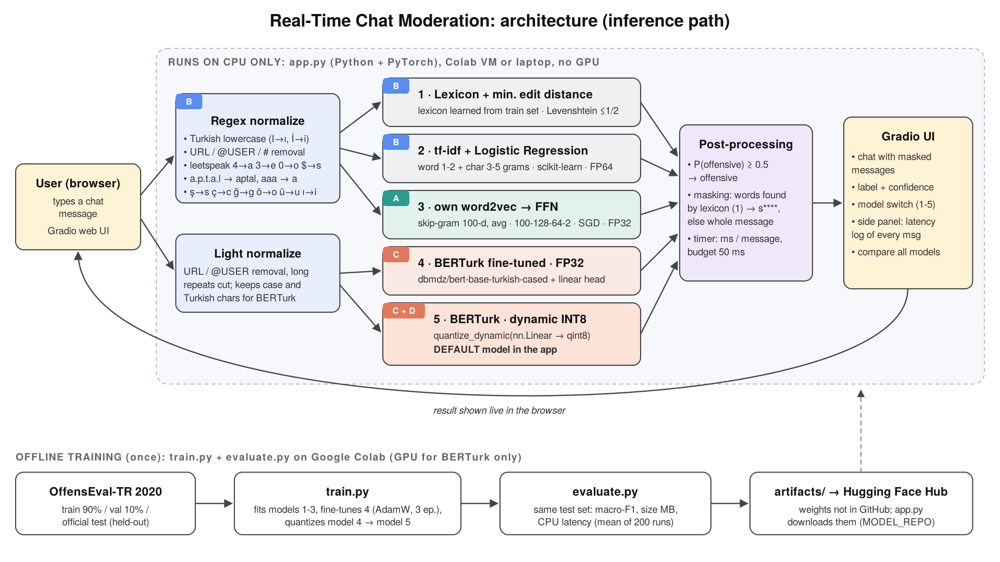

# SWE015 Homework: Real-Time Chat Moderation (Use Case 4)

A gaming platform must flag offensive Turkish chat messages **within 50 ms per message on a CPU-only server**.
This repository contains a working Gradio chat app plus the full model ladder, evaluated on the same held-out test set:

| # | Model | Area | Role |
|---|---|---|---|
| 1 | Lexicon + minimum edit distance | B | rule baseline |
| 2 | tf-idf (word + char n-grams) + logistic regression | B | classical baseline |
| 3 | Own word2vec (skip-gram, trained on the training tweets) → feedforward network (SGD + backprop) | A | neural network |
| 4 | BERTurk (`dbmdz/bert-base-turkish-cased`) fine-tuned, FP32 | C | Transformer |
| 5 | Model 4 after **dynamic INT8 quantization** (`torch.ao.quantization.quantize_dynamic`) | C + D | **used by the app by default** |



## Technique map

| Component | File | Technique (area) |
|---|---|---|
| Noisy-text normalization: Turkish lowercasing, URL/@USER removal, leetspeak, `a.p.t.a.l`, repeated letters, ASCII folding | `moderation/normalize.py` | regular expressions, text normalization, tokenization (B) |
| Rule baseline: lexicon learned from training data (add-α smoothed precision) + Levenshtein matching | `moderation/models.py` → `LexiconMatcher`, `min_edit_distance` | minimum edit distance (B) |
| Baseline classifier | `moderation/models.py` → `TfidfLR` | tf-idf (B) |
| Own embeddings + network | `moderation/models.py` → `W2VFFN`, `FFN` | word2vec, feedforward network, SGD, backpropagation, dropout (A) |
| Transformer classifier | `train.py` → `train_bert`, `BertClassifier` | fine-tuning BERT with a task head, WordPiece tokenizer, attention (C) |
| Quantized model + benchmark | `moderation/models.py` → `quantize_dynamic_int8`, `evaluate.py` | quantization, benchmarking size / latency / accuracy (D) |
| Masking of flagged messages | `app.py` → `mask_message` | edit-distance lexicon (B) |

## Setup and run

Requirements: Python 3.10+ and ~2 GB disk.

```bash
git clone https://github.com/yavuzdilmen/swe015-chat-moderation.git
cd swe015-chat-moderation
pip install -r requirements.txt
```

**Run the app (single command)** with the trained weights from the Hugging Face Hub:

```bash
MODEL_REPO=yavuzdilmen/swe015-chat-moderation python app.py
# Windows PowerShell:  $env:MODEL_REPO="yavuzdilmen/swe015-chat-moderation"; python app.py
```

Then open http://localhost:7860. Weights: https://huggingface.co/yavuzdilmen/swe015-chat-moderation

**Reproduce everything from scratch** (GPU recommended for BERTurk; on Colab just open `colab_run.ipynb`):

```bash
python train.py        # trains models 1-5, saves ./artifacts   (~15-25 min on a T4 GPU)
python evaluate.py     # writes results/results.md, results.json, failures.md, results_chart.png
python app.py          # starts the app on ./artifacts
```

Quick check that the code runs (1 minute, synthetic data, tiny random BERT, no downloads):

```bash
python train.py --smoke && python evaluate.py --smoke && python app.py --smoke
```

## Data

**OffensEval-TR 2020** (Çöltekin, 2020): Turkish tweets labelled NOT / OFF (sub-task A).
* train → 90 % of the official training set (stratified, seed 42); val → the other 10 % (model selection only)
* test → the **official test set**, used as the same held-out set for all five models

`train.py` downloads it from the Hugging Face Hub (`coltekin/offenseval2020_tr`). If that fails, put either
`train.csv` + `test.csv` (columns `text,label`, label 1 = offensive) or the original shared-task TSV files into
`data/` and run `python train.py --data_dir data`.

> Çağrı Çöltekin. 2020. *A Corpus of Turkish Offensive Language on Social Media.* Proceedings of LREC 2020, pp. 6174–6184.

Pretrained model: Stefan Schweter, *BERTurk: BERT models for Turkish* (`dbmdz/bert-base-turkish-cased`), Zenodo 2020.

## Results

See [`results/results.md`](results/results.md) (generated by `evaluate.py`; macro-F1, size in MB, CPU latency averaged
over 200 single-message calls, hardware stated in the file) and [`results/failures.md`](results/failures.md).

## Repository layout

```
app.py                  Gradio chat app (model switch, masking, latency log)
train.py                trains the whole ladder + quantization
evaluate.py             same test set for every model → results/
upload_weights.py       pushes ./artifacts to the Hugging Face Hub
colab_run.ipynb         the full run on Google Colab
moderation/normalize.py regex normalization (area B)
moderation/data.py      data loading and splits
moderation/models.py    the five models
docs/architecture.*     architecture diagram
```

## AI usage

Claude (Anthropic) was used to draft the code, the architecture diagram and the slide layout. All training runs and
all reported numbers were produced by me with the code in this repository.
